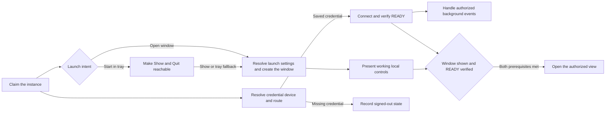

# Serein desktop startup design

Make the first local action available as soon as the platform can display a small, correct
window. Restore the saved session independently. A cold launch into the tray should only
prepare the things the user needs while hidden. Reopening a window that is already running
should reuse its renderer and session.

This design builds on the session-restore behavior in PR #1 at `5340c069`. The native debug
trace measured 957 ms to first visible content on repeat launches and 1,368 ms with a fresh
profile on Linux Xvfb with software rendering. On repeat, preparing Twemoji took 227 ms and
the first UI callback took 186 ms. The full atlas accounted for 16.5 MB of roughly 20 MB of
staged textures. SQLite initialization took 2 ms on repeat and 24 ms on fresh profiles.
Those results prioritize asset preparation and the first UI pass. Release budgets need
matching hardware baselines. [Startup measurements](performance.md#launch-phase-trace-at-5340c069) ·
[Session-restore PR](https://github.com/Neur0nz/Serein/pull/1)

## Launch and restore paths

| Entry | First usable result | After that |
| --- | --- | --- |
| Open Serein from a stopped process | Claim the instance and present a small sign-in or workspace shell with working local controls. Resolve the credential in parallel. | Apply the verified session and fill the view the user is looking at. |
| Start minimized | Preserve the taskbar or Dock entry and current platform minimize behavior. | Continue background session work and restore the existing window when asked. |
| Start in tray, proposed opt-in | Claim the instance and make Show and Quit usable through the native desktop. Create a visible window if a reliable reopen route is unavailable. | Restore the session when a saved login exists. On first Show, create the renderer and present the current sign-in, restore, or live state. |
| Show a window already parked in tray | Focus and paint the same window with its existing session and view. | Refresh the visible view if needed. Recover a disconnected session in place. |

Route manual relaunch, notifications, Dock activation and tray Show to the primary
instance. Coalesce repeated Show requests while a window is being created. Keep the
current activation behavior until the native transport can distinguish explicit Show
from background autostart. Windows and Linux currently carry a show-only signal.
Before offering quiet secondary autostart, test intent delivery and ordering against a
concurrent manual Show and preserve each platform's focus rules.
[Single-instance routing](../crates/platform/src/single_instance.rs) ·
[Platform startup and tray behavior](platform-support.md)

| Profile state | What appears when the window is open |
| --- | --- |
| Confirmed missing credential, typical of a first run | A local sign-in view using the available appearance and defaults. Start interactive authentication in response to the user. A tray launch can wait in a signed-out state. |
| Saved credential, no usable history | A stable workspace shell while connecting. After READY, open the remembered channel if accessible and still appropriate, otherwise Home. Request fresh history for the selected chat. |
| Saved credential and usable history | Apply local appearance early. After READY verifies the account and current access, use the normal history path to show cached messages for the selected conversation and refresh them in place. |
| Old, locked, corrupt or incompatible storage | Use readable launch settings or per-launch defaults. Keep local controls responsive during recovery. Continue live account and history work when its own prerequisites are available. Report the storage state and protect the existing data. |
| Credential provider locked, slow or unavailable | Offer retry or another account. Preserve the saved entry on transient failure. A definitively expired credential follows the existing sign-in recovery flow. |
| Service slow, rate-limited or offline | Keep local controls available and show the connection state. A previously verified session may retain its authorized in-memory view under existing stale-state rules. A cold launch waits for verified identity and permissions before showing private account data. |

An empty database can coexist with a valid OS credential. Treat driver cache warmth,
profile data, credential state, and an already-resident process as independent conditions.
When READY has arrived and a remembered conversation is resolving, keep the live
navigation usable and use a small loading state in the content pane. Manual navigation
wins immediately. A missing, inaccessible or timed-out selection settles on Home.
Invalidate the pending restore request when the user navigates or the lookup expires.
Discard a late result and schedule the normal authorized history request once for an
accepted selection.

## Work before each milestone

| Work | Earliest useful deadline | Execution and scheduling |
| --- | --- | --- |
| Instance claim and startup intent | Before starting services or touching the store | Reuse instance routing. Latch the primary process's first Show even if the renderer and session are still starting. |
| Renderer, chrome, transparency and window geometry settings | Before creating the visible window | Read the small launch settings with the existing store. Use the chosen values for the entire first window. When testing an asynchronous slow path, start with a 25 ms presentation wait budget after independent preparation is ready. Use per-launch defaults after the deadline. |
| Native desktop registration and window | Before a usable tray or first window | Use the platform event loop and required native handle. Confirm the app can be reopened. Register recovery on host loss, including an accessible window if needed. |
| Core graphics context, UI pipeline and first-frame assets | Before the first visible frame | Use the compatible adapter and surface and preserve driver fallback. Prepare only the needed fonts, icons and basic chrome. The first frame should already contain real controls. |
| Saved credential and native credential store | Before session identification | Start the existing credential worker early. Preserve authoritative credential selection, native lookup deadlines, and the existing plaintext fallback rules. Surface transient failures separately from missing saved credentials. |
| Device identity, proxy settings and transport bootstrap | Before sending requests that require them | Restore device data and resolve the applicable route in parallel with presentation and credentials. Preserve the configured proxy's fail-closed behavior and transport scope, including granted pre-login activation and secured proxy credentials. Defer unrelated extension work. |
| Presence for the initial connection | Before identifying with any advertised presence | Use a trustworthy account binding for remembered presence. Investigate removing the local presence read from cases that cannot use it. Keep remote resolution or the existing invisible fallback when status is unknown. |
| Account store open, schema checks and migration | Before a feature consumes the affected rows | Keep one ordered store path. Preserve schema compatibility and failure handling. Run migrations off the window thread where possible, and keep accepted writes and clear, delete and logout operations in order. |
| Gateway READY and verified navigation | Before authenticated account data is available | Prepare the payload and permission data on the worker. Apply identity, navigation and permissions coherently. Scope results to the current session generation. |
| Remembered selection and history | When the authenticated workspace is shown or the user selects a chat | Enqueue the small remembered-selection read ahead of settings-only reads when it is needed. Use existing history admission and prioritize the selected view. Apply results only while account, generation, selection, request, permissions and history epoch agree. |
| Custom fonts and approved extension start screen | Before their respective visible state needs them | Keep the approved screen's precedence when it is ready for the first view. Apply the existing permission checks. Prepare bounded first content off the UI thread. If it misses first paint, keep local controls usable with the core shell and keep that presentation stable through the attempt. |
| Emoji, optional icons, avatars and rich media | When the visible view uses the asset | Defer both preparation and GPU upload. Start video conversion when Play, Watch, or a visible incoming video asks for it. Overlap setup with decode or stream negotiation and publish the result without waiting in paint. |
| Settings-only data, discovery and ordinary maintenance | On feature demand or after the interactive path settles | Use demand-driven reads for font enumeration, GIF favorites, and autostart status. Defer optional artwork scans and automatic update checks subject to a bounded delay. Explicit requests take priority. |

For video, distinguish a pending converter from a renderer that cannot support it.
Keep only the latest bounded frame while setup finishes, then present it for the
active media request. Prepare any supported CPU fallback on a worker. Exercise slow
and failed setup so the first paint path stays responsive during playback startup.

Window creation and a compatible device and surface are real dependencies of first
paint. Keep the no-flash presentation path. The initial local action should work with
credential, cache and network requests pending. Preserve the layout and focus when
background results arrive. Late settings reads can populate untouched live fields for the
current settings revision. User edits take precedence. Apply immutable settings on the
next launch, preserve their on-disk choices, and suppress writes of a fallback row.

Keep one store and its existing ordering. Preserve a migration's atomic boundaries and
data validation, including databases with compatible nullable additions at the same
schema version. Begin by measuring locked and legacy profiles, and retain the measured
fast current-schema path. Consider a minimal read followed by worker initialization if
the slow path blocks presentation. Measure the added read and failure paths before
introducing a separate file for preferences. If introducing a presentation deadline, bound
the wait for the worker result outside SQLite. A SQLite busy timeout covers database locks
and cannot bound all filesystem stalls. Distinguish a missing row from an unread row.
[Storage policy](storage-policy.md)

## Foreground work and background capacity

- Admit work required by a visible control or the live session as soon as its
  dependencies are ready. Keep a foreground result's path through worker, queue, reducer
  and repaint free of waiting on optional work. Put the currently selected history and
  requested artwork ahead of preloads.
- Use existing bounded queues and per-subsystem admission. Leave settings-only reads
  outside the SQLite queue while a critical read is pending, and preserve the order of
  accepted writes, clears and deletes. Let disk pruning yield between bounded units.
  Hold optional decoded art before calling `load_texture`, since the painter drains
  queued texture deltas. Enqueue only first-view textures initially and budget later
  uploads by pixels or bytes.
- Start with demand-driven work. Keep speculative warmup out of the initial presentation
  and session paths. Add it only where it measurably reduces first-use latency. Start
  with one admitted optional unit across participating startup workers, coalesce
  duplicates, and let a user action adopt an in-flight result. Pause admission with
  foreground input, an active restore, a pending Show, or a frame backlog. Test
  contention from a disk or driver call that is already running. In cold tray mode
  keep presentation-only work deferred until accepted Show.
- Preserve rate-limit handling for network work. Confirm desktop speculative calls reach
  the existing REST admission classes before adding any startup prefetch. Do local
  catch-up and explicit foreground history through the normal request path.
  [Desktop prefetch dispatch](https://github.com/Neur0nz/Serein/blob/5340c069fc42616ddd01836c1cf27a1028ebfdd8/apps/desktop/src/connection.rs#L1325)
- Use existing bounded artwork, channel and driver caches. Generate measured, immutable
  asset indexes at build time where it pays off. Compare warm driver cache with fresh
  driver cache before considering app-managed shader persistence. Account cache
  invalidation, visible permission checks and current scale remain part of reuse.

The work should be removable from the first-frame queue, including any upload a worker
prepares early. Protect both the first visible frame and the first foreground action
after it. Review worker joins, synchronous waits, and queue admission at both points.
Measure the first emoji view and first video frame when deferring their setup.

## Tray lifecycle and failure handling

Retain an existing window and core renderer when parking it in the tray. Suppress UI
passes and drawing while hidden. Verify the parked state under compositors that cannot
report native visibility. Evict optional artwork and media allocations when
safe. Keep the session, notifications, cache persistence, active calls, permitted
hotkeys, logout and Show/Quit handlers running. Preserve the current difference between
close-to-tray and ordinary minimize for attachment playback. Reuse the renderer on Show
and recover a lost surface without restarting the session. Scope converters, textures
and late upload results to the live graphics device before supporting replacement of
that device. Consider core renderer eviction only if idle memory savings justify a
measured slower Show.

Use one native event loop for cold tray mode. The session pump must wake on both
worker completions and the nearest pending deadline for credential timeouts, saves,
retries and presence expiration without relying on egui repaint timers. Move required
work tied to visible UI passes, including enabled activity synchronization, onto that
path. Keep native handles and callbacks on the correct thread. On Windows preserve
Explorer restart handling through a hidden top-level notification HWND or equivalent
broadcast reception. On macOS use a main-thread activation command that can create
or reveal the window. On Linux verify StatusNotifier and compositor recovery. Try
hosting the existing eframe `create_native` entry point on the caller's main-thread
event loop before changing the renderer integration. Normal eframe app creation
currently initializes WGPU first. The prototype must isolate a failed first Show
from the host event loop's exit path. Keep the tray, session and saves working and
offer retry or Quit if device or surface initialization fails.
[Eframe integration](https://github.com/Neur0nz/Serein/blob/5340c069fc42616ddd01836c1cf27a1028ebfdd8/vendor/egui/eframe/src/native/wgpu_integration.rs#L244) ·
[Platform tray support](platform-support.md)

Cancel or Use a different account invalidates pending credential, network and cache
outcomes for that attempt. Clear a parked secret and let a late native keyring call
finish under its existing bounds without applying its result. Distinguish retryable
route, storage and credential failures. Keep device and proxy settings scoped correctly
and keep verification explicit. While a call or authorized save is in progress, preserve
its existing lifecycle and delivery semantics.

Clean Quit and OS session logout must finish without building a renderer. Explicit Quit
keeps the existing bounded drain for accepted writes and local saves. A deadline,
unsaved change or ambiguous write can require confirmation. For that case, expose a
reachable confirmation surface. If WGPU fails, use a supported native confirmation or
keep the process reachable with retry while retaining unresolved work. OS logout
follows its existing exit path without waiting for a prompt. Stop admitting optional
work and fence new Show requests once shutdown commits. Keep already-dispatched writes
and required cleanup under their existing rules. [Current close behavior](design.md)

## Performance targets

The proposed budgets are in milliseconds for packaged release builds with voice enabled
and the ordinary renderer policy. Reference hardware means supported SSD systems with a
mainstream hardware GPU, measured separately per platform. Use an older supported iGPU
and SSD as a lower-end cohort. Treat first local UI and live session readiness as
separate measurements.

| Milestone | Reference p50 / p95 | Lower-end p50 / p95 |
| --- | ---: | ---: |
| Repeat process launch to meaningful pixels | 250 / 400 | 450 / 750 |
| First-run process launch to meaningful pixels | 450 / 750 | 700 / 1,100 |
| Cold tray launch to working Show and Quit | 225 / 350 | 350 / 600 |
| First Show after cold tray launch to meaningful pixels | 250 / 400 | 450 / 750 |
| Show with a resident renderer to meaningful pixels | 90 / 150 | 130 / 225 |
| Early local action to visible response | 45 / 75 | 65 / 110 |

Use the reference budgets as planning targets. Measure release Serein and a minimal
release eframe window with the same device, adapter, compositor, size, scale and window
settings before turning them into gates. If the practical renderer floor makes a target
unrealistic, use a same-device target of removing roughly a third of Serein's measured
overhead above that floor. Where repeat launch has headroom, consider a stretch target of
200 ms p50 and 325 ms p95. Preserve focus, appearance, input latency and memory usage
when selecting a target. Record any benchmark-dependent change to the target before
comparing results.

The repeat and first-run window rows use ordinary packaged no-account launches so
external credential or Discord timing cannot move those budgets. First-run uses a new
profile, empty OS credential namespace and a fresh driver cache. Repeat uses an
initialized profile and reused driver cache. Track disk and OS page-cache conditions
separately. Repeat the presentation
tests during a delayed saved-login restore, with empty and populated history as separate
fixture cohorts. Exercise cold tray with both credential states, with the renderer absent,
and time its first Show with the session both pending and ready. The resident row begins
with a parked window and existing renderer. A missing tray host exercises the foreground
fallback and has its own results.

Start timing at the external launch or native Show activation. Meaningful pixels show
the expected sign-in, restore or workspace controls and preserve the first-view layout.
Track blank, wrong-view and transient focus frames. Inject a benign local action, such as
focusing a sign-in field or activating the restore shell's account control, at the first
eligible frame. Time through its visible response. End the tray readiness timer when
the native host confirms a reachable registration with Show and Quit installed.
Validate each action in a separate trial.

Measure time to worker READY, UI-applied READY, first authorized workspace and first
fresh history independently. For controllable offline fixtures, time the local handoff
from READY while presentation is already available. Set a release budget from its own
baseline. Live WAN, keyring prompts and elapsed time before the user chooses Show are
reported separately from client work.

## Implementation and review order

1. **Establish release baselines.** Build the package and a minimal same-renderer control.
   Capture real visible pixels, map and present separately, and exercise the first local
   response with synthetic input. Keep the prior Linux software-rendered trace for
   diagnosing phase costs. Break out adapter probing from the matched renderer floor.
   If that probing matters, test trying an explicitly selected backend first while
   retaining compatible fallback and the current Automatic ranking.
2. **Reduce the first frame.** Compare upstream demand-driven emoji work with the current
   atlas. Defer unused icon variants and media pipelines using the same foreground
   profile, keeping the first-view layout and artwork intact. Profile the first UI pass
   before reorganizing it. In the built-in sign-in and skeleton fixtures, assert the full
   unused atlas is neither decoded nor queued before the first meaningful frame. Record
   staged bytes at fixed scale. Include non-Latin first content and fractional and 2×
   scale to check font fallback, first-use glyphs and icon sharpness.
3. **Remove avoidable waits for the session.** Overlap independent credential, route
   and device work. Prioritize the authenticated remembered-channel read and keep
   application/user selection authoritative. Change storage startup only in a measured
   bottleneck case. Coordinate changes to READY and selection with PR #1's ownership.
4. **Verify resident tray reopen.** Time Show and first response with warm, long-hidden
   and disconnected state. Verify native activation, memory/idle CPU and rendering
   behavior. Keep the renderer while its cost is justified.
5. **Prototype cold tray as opt-in.** First prove Show, Quit, host loss, logout and native
   activation with no renderer present. Cover competing Show and Quit requests and
   force a first-Show graphics failure while preserving the tray and session. Then
   wire normal saved-login restore and first Show. Assert that ordinary tray startup
   and clean shutdown leave renderer creation to accepted Show or foreground fallback.
   Measure both tray readiness and the first usable window.

Use a release-equivalent fixture build for authenticated startup. Inject a synthetic
credential at the credential worker boundary and bounded loopback or scripted Gateway
and REST responses at the transport boundary. Exercise the real route, generation,
store and permission checks. Report those results separately from no-account packaged
measurements. Timing remains local and opt-in. Treat any separately authorized live
trial as observational.

The focused regression cases cover the transitions that can invalidate results:

- Current and legacy schema, interrupted migration, incompatible schema and corrupt
  store. For the slow path, hold a database lock beyond the presentation deadline.
  Verify usable fallback pixels, a responsive local action, preservation of saved
  immutable preferences, and a user setting edit that survives the delayed read.
- Missing credential, transient keyring error, cancel during credential load or
  deferred connect, explicit proxy paused or invalid, and slow or failed Gateway
  startup. Check that failures retain the appropriate retry or sign-in path.
- Delayed, inaccessible or stale remembered selection, manual navigation, permission
  loss, account switch and stale history completion. Verify current-account data only
  and at most one selected-chat history request for one accepted restore.
- Resident Show after a short or long hide, reconnect, compositor or tray host loss,
  duplicate manual Show and autostart, and shutdown with empty, draining or ambiguous
  work. Check native session logout and retained media behavior.

Alternate baseline and candidate packaged launches with matched fixtures and record
backend, driver, compositor, refresh, display scale, OS cache condition and thermal or
power mode. Use 10–20 launches for exploratory medians. Before gating on p95, collect
at least 100 per core cohort across repeated sessions. Freeze the expected outcomes,
timeout, median and nearest-rank p95 definitions, practical regression tolerance and
replication rule before candidate runs. Require each core fixture to complete in the
expected state. Report any failures or timeouts out of all attempts even when displaying
latency for completed runs. Repeat an inconclusive paired block with both builds.

Report first-click and first-use media latency, early frame pacing, texture bytes, and idle
CPU, process memory and GPU memory where available. Compare the first foreground input
with optional warmup in flight and test long-hidden retention. Keep phase spans separate
from end-to-end observations and compare release package sizes for extra assets.
